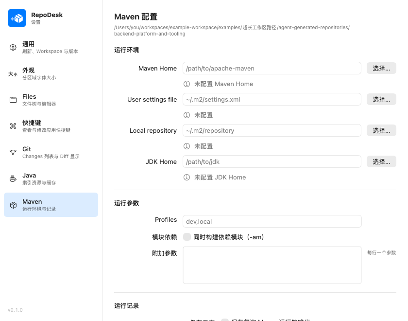

# RepoDesk

RepoDesk is a native macOS workspace desk for reviewing Agent-produced repository changes, editing workspace files, performing explicit Git operations, and running Maven lifecycle goals. It includes background Java indexing and source navigation through a managed language server, but is not a full IDE or debugger.

RepoDesk 是一个原生 macOS 多仓库工作台：集中查看代码变更、Diff/Blame/历史，编辑文件，处理 Git 分支和冲突，运行 Maven，并提供 Java/MyBatis 导航。项目采用 [MIT](LICENSE) 许可证；随包组件保留各自的[第三方许可](Support/ThirdParty/NOTICES.md)。

## 安装与首次使用

- 系统目标为 macOS 14+。Apple Silicon 和 Intel 需要分别构建，应用包内含与 CPU 架构匹配的 Java 运行时。
- 当前仓库提供源码构建流程。只有发布者实际提供了下载包时，才从仓库的 Releases 下载；`adhoc` 文件是开发测试包，`notarized` 文件才经过 Apple 公证。
- 解压后把 `RepoDesk.app` 放入 Applications。首次打开选择自己的工作区目录，再发现或添加其中的 Git 仓库。
- Git 功能需要可用的 `/usr/bin/git`；首次使用前安装 Apple Command Line Tools，配置自己的 Git 身份及远程认证。
- Maven 页面可设置 Maven Home、项目 JDK、settings 文件和本地仓库。也支持项目的可执行 `mvnw`。从 Finder 启动时不保证继承终端的 PATH，使用 Homebrew 等安装的 Maven 时建议明确设置 Maven Home。
- Java 语言服务和 CFR 随应用打包，不要求为了代码导航额外安装 JDK；执行项目 Maven 构建所需的 JDK 仍需按项目配置。首次构建会联网下载固定版本的运行时并校验 SHA-256。

已有用户更新时保留 Bundle ID、偏好设置键、工作区记录及 Maven 配置，无需重新设置。语言服务正式版本使用独立索引缓存；首次打开 Java 项目可能重新索引，原缓存不会被覆盖。

本机数据存于当前用户的 Preferences、`~/Library/Application Support/RepoDesk` 和 `~/Library/Caches/RepoDesk`；这些数据不属于源码包。诊断日志和可选 Maven 历史日志可能包含项目路径或构建输出，分享前请检查。

配置界面示例（使用虚构工作区渲染，不包含真实项目数据）：



## 学习与参与开发

先读 [架构与模块边界](docs/architecture.md)，再看 [产品范围](docs/product-spec-v0.1-amendment.md) 和 [贡献说明](CONTRIBUTING.md)。构建与验证见下文；公开源码、打包、签名和公证步骤见 [发布指南](docs/publishing.md)。CI 产物是开发测试包，不会自动发布到 GitHub Releases。

RepoDesk v0.1 connects workspace and nested-repository management, automatic multi-repository Git status, structured diff/history review with per-side Blame, selectable Commit and Commit And Push, repository Fetch/Pull/Push, Branch operations and merge-conflict resolution, editable workspace files, and an IDEA-style Maven module/lifecycle view with environment validation, final-command preview, process-group stopping, POM synchronization, streamed output, and recent-run replay. Workspace and Repository contexts expose different top-level modules. The staged implementation, replacement verification, and final user acceptance are complete.

Maven commands share a FIFO queue within each Git repository; different repositories can run concurrently. Triggering a command while another runs adds it to the queue, using the parameters captured when submitted. Duplicate running or queued commands show their status instead of creating another entry. Recent runs show a spinner for the active command, queue positions and individual remove buttons for waiting commands, and results and logs after completion. Failure or Stop clears that repository's waiting commands. Queues are session-only and are stopped when the workspace closes or changes; completed history follows the configured retention and log persistence settings.

## Requirements

- macOS 14+
- Xcode with the macOS SDK (Swift 6)
- [XcodeGen](https://github.com/yonaskolb/XcodeGen)

## Build and test with Xcode

```sh
xcodegen generate
xcodebuild -project RepoDesk.xcodeproj -scheme RepoDesk -configuration Debug build
xcodebuild -project RepoDesk.xcodeproj -scheme RepoDesk test
```

`RepoDesk.xcodeproj` is generated and intentionally ignored. Edit `project.yml`, then regenerate the project.

When only Apple Command Line Tools are available, build a directly runnable app bundle with:

```sh
./scripts/verify-local.sh
open build/RepoDesk.app
```

The verification script runs strict-concurrency type checking, parses the test sources, executes functional, integration, rendering, and repeatable performance fixtures, generates the app icon, builds `RepoDesk.app`, verifies version `0.1.0`, and checks the ad-hoc signature. It does not replace the XcodeGen test workflow when full Xcode and Swift Testing are installed.

The final local artifact is `build/RepoDesk.app`. Release contents, accepted replacement coverage, known limitations, and the App icon generation record are in `docs/release-v0.1.md`.

### Find commits by hash in History

Use “按 Commit Hash 筛选…” above the commit list to filter by a short or full hash prefix. Matching ignores case and surrounding whitespace, searches the complete history within the selected Branch and User filters, and preserves the file scope when viewing file History. A single result is selected automatically; ambiguous prefixes show matching commits in history order with normal pagination. Clear the field to restore the unfiltered list. The search is cleared when switching repositories.

### Files, search and navigation responsiveness

Open files use a fixed single-row tab bar with horizontal scrolling and an “所有打开的文件” menu. Selecting a file from search, navigation or that menu scrolls its tab into view. Closing tabs keeps the editor at the same vertical position. Files retains its editor, caret and selection when visiting another section; the inactive editor releases keyboard focus and Find commands.

In Files, `Command++` (also `Command+=`) and `Command+-` adjust the current tab's text size by one point, from 10 to 40. `Command+0` restores the configured default. Source and Markdown preview share the tab's temporary size; switching tabs retains it, while closing the tab or restarting the app resets it. These shortcuts leave global font preferences and file contents unchanged.

The file tree lazily renders visible rows, including expanded directory descendants, and reuses filename width measurements for horizontal scrolling. Filename and content searches include source repositories ending in `.service`, while still skipping generated directories and known application bundles. Content search publishes partial results, cancels obsolete scans and preserves the previous results with an updating indicator until the new query produces results. Previous-query results cannot be opened while marked as stale.

Re-entering unchanged History reuses its loaded data. Explicit refresh, repository HEAD changes, workspace events and foreground consistency checks invalidate it. The default commit list can load while branch and author metadata are read; named branch/author and “Select Me” filters still resolve their metadata before loading commits.

`scripts/verify-interaction-responsiveness.swift` verifies source-package searches, partial results and cancellation, History caching and filter validation, retained editor focus/selection, and single-row scrolling tab geometry. It runs as part of `verify-local.sh`.

### JAR changes in History

Select a changed `.jar` in History to compare its internal files. The upper list shows added, deleted and modified entries; enable “显示未改动文件” to browse everything. Select a `.class` to compare Java decompiled with the bundled CFR runtime, or select a text resource for a direct side-by-side diff. The lower pane supports search, selection, copying and ignoring whitespace. For merge commits, choose which parent to compare against.

Both sides come from Git objects, including renamed and deleted JARs; the working tree is never used as historical content. Archive timestamps and compression changes alone do not count as file changes. Bytecode changes with identical decompiled Java are identified explicitly. Decompiled code does not reproduce original comments or formatting.

The build prepares CFR 0.152 with a fixed SHA-256 and embeds its MIT license; preview works offline. Previews support ordinary ZIP/JAR entries stored or deflated, UTF-8 and BOM-marked UTF-16 text, JARs up to 256 MB and individual entries up to 16 MB. Unsupported ZIP64, encrypted/corrupt archives and unreadable entries show an explanatory error. `scripts/verify-history-jar.swift` verifies real Git snapshots, archive changes and Java decompilation.

### Java navigation UI acceptance

Run `./scripts/verify-local.sh` to prepare the managed Java runtime and verify the local app, then generate/open `RepoDesk.xcodeproj`. In Xcode, select the `RepoDeskUIAcceptance` scheme with `My Mac` as the destination and choose Product → Test (`Command+U`). Run this in the logged-in macOS desktop session with Xcode automation access available; avoid interacting with the tested app while the suite runs.

The XCUITests in `RepoDeskUITests/JavaNavigationUITests.swift` exercise the real editor and Java language server:

- `Command+left click` on a class/type or a method invocation opens its definition, including return/parameter types.
- `Command+left click` on the method name at its declaration finds incoming call sites; multiple sites are offered for selection. No callers means no jump, not a fallback to the definition.
- Plain left click continues to place the caret/select text without navigation.
- `Command+B` always opens the definition, including when invoked on a method declaration; it never switches to callers.
- Source navigation vertically centers the target when the file has enough surrounding content; positions near a document boundary clamp to the available content.
- `Option+Command+B` offers implementations of the selected Java type or method and opens the selected source. `Option+Command+Return` remains an equivalent shortcut.
- `Command+U` opens a parent declaration, followed by back/forward navigation using `Option+Command+Left/Right`.
- `Command+O` and `Option+Command+O` search Java types and symbols and open their targets.

The suite creates a small temporary Java repository and isolated application preferences rather than using the user's Workspace. Search input is pasted literally so the active input method does not alter identifiers; the prior clipboard contents are restored if nothing else changes the clipboard. Failure screenshots and accessibility hierarchies are available in Xcode's test report. These UI tests complement, rather than replace, the functional/rendering checks and signed standalone app build in `verify-local.sh`.

The click rules above supersede the previous “Command+click always finds callers” behavior. The language server's hierarchical document symbols determine whether the click lies within a method name's `selectionRange`, rather than its whole signature/body or a matching word elsewhere. The current unsaved document is synchronized before resolving symbols. Incoming calls use their actual `fromRanges`, so navigation lands on the invocation, not the caller's method header. The JDT integration fixture also verifies overloads, annotated multiline signatures, return/parameter types and unsaved source changes.

For a method declaration in a MyBatis Mapper interface, `Option+Command+B` (or `Option+Command+Return`) first searches XML files in the same Repository, including other modules. The XML `mapper` namespace must exactly match the interface's qualified name, and the `id` of a `select`, `insert`, `update`, or `delete` must exactly match the method name. A single match opens the XML and selects the SQL statement's `id`; multiple matches offer a choice. If no XML statement matches, navigation falls back to Java implementations. XML comments, CDATA, build outputs, and nested Git repositories are excluded. Back/forward preserves both the original Java caret and the XML location. `scripts/verify-mybatis-navigation.swift` verifies these rules through the resolver and application state.

### Java metadata location

RepoDesk starts JDT LS with `-Djava.import.generatesMetadataFilesAtProjectRoot=false`. Newly generated Eclipse metadata (`.project`, `.classpath`, `.factorypath`, and `.settings`) is redirected to the per-repository Java cache under `~/Library/Caches/RepoDesk/JavaLanguage/`, not written into the source repository. No repository `.gitignore` or Git-local ignore configuration is changed.

JDT LS continues to use metadata that already exists in the source repository; this setting does not migrate or delete it. Files generated by older RepoDesk builds must be inspected separately before any backup/removal, especially when a repository already tracks Eclipse configuration. Build-tool output such as Maven's `target/` is separate from Eclipse metadata and is not covered by this redirection. The real JDT integration verification checks that a fresh source fixture gains none of the four metadata entries and that its project/classpath metadata exists in the external cache.

## Project map

- `RepoDeskApp/App` owns application lifecycle and in-memory shell state.
- `RepoDeskApp/Domain` holds value types with no UI concerns.
- `RepoDeskApp/Features` contains feature views; they depend on state through focused, explicit inputs.
- `RepoDeskApp/Repository` owns registration validation, persistence, directory selection, and filesystem discovery without invoking Git.
- `RepoDeskApp/Git` owns Git queries, parsing, and the bounded set of explicit v0.1 write operations.
- `RepoDeskApp/Files` owns lazy workspace browsing, optional compact single-child folder presentation, recursive debounced file-system monitoring, incremental tree refresh planning, filename search, block-level Markdown parsing, encoding-preserving document loading/saving, and external-write conflict detection.
- `RepoDeskApp/Maven` owns Workspace Maven/JDK settings and validation, multi-module POM scanning and refresh planning, lifecycle command construction, recent runs, log retention, and Maven presentation models.
- `RepoDeskApp/Settings` owns application-wide refresh, Files, and Git preferences plus compatibility migration from legacy preference keys. Git settings include Changes automatic expansion (by count, always, or never; default threshold 10) and Diff display preferences. Changes defaults apply when entering the view, switching repository scope, or changing grouping; manual expansion choices survive refreshes in the current scope.
- `RepoDeskApp/Tasks` retains the reusable local task/process foundation and stops complete process groups; the v0.1 user-facing module is Maven rather than a generic Tasks editor.
- `RepoDeskApp/Process` and `RepoDeskApp/Diagnostics` own bounded command execution, cancellation, timeout handling, and rotating local diagnostics.
- `RepoDeskTests` tests domain and state behavior with Swift Testing.
- `Support/Resources` contains the 1024px App icon master and generated ICNS resource.
- `docs/architecture.md` defines the intended module seams for later milestones.

The original v0.1 product baseline is kept as the historical starting point in `docs/product-spec-v0.1.md`. User-approved file editing, Git Review, navigation, Maven, Blame, and explicit Git write-operation changes are recorded in `docs/product-spec-v0.1-amendment.md` and override conflicting baseline text.
Development and user acceptance proceed through the four large functional stages defined in `docs/product-acceptance-stages-v0.1.md`.
The current implementation and verification snapshot is summarized in `docs/v0.1-acceptance.md`.
